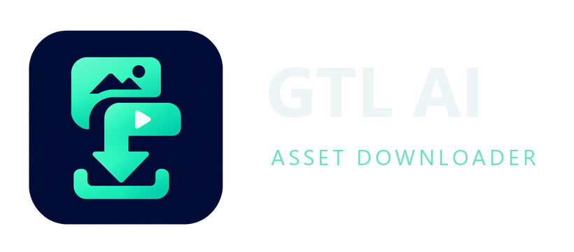
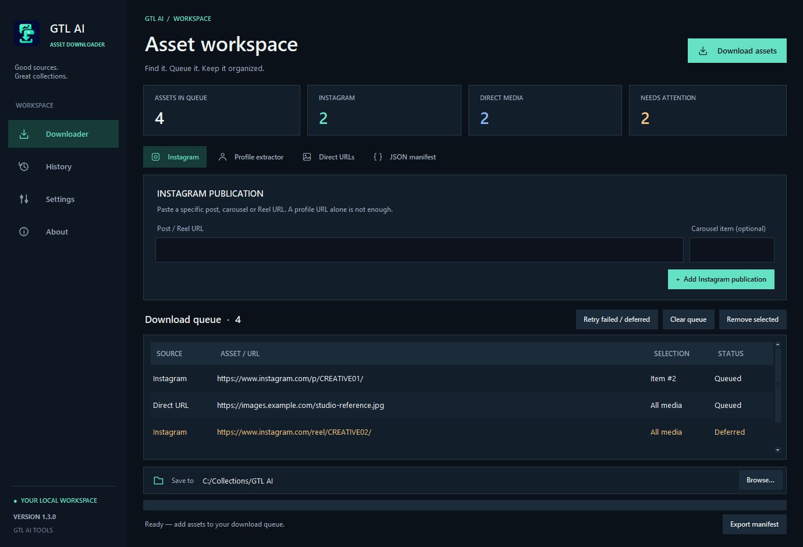

# GTL AI Asset Downloader — Desktop Edition 1.3.0



A local Windows workspace for collecting selected Instagram publications and direct media URLs into organized ZIP packages with source metadata and download reports.



## New in 1.3.0

- Navy and mint visual design, new media/download logo, and a Windows icon with seven embedded sizes.
- Persistent source forms and profile results when switching modes or navigating between pages.
- Live queue summaries, status colors, an empty state, and a download action that stays visible. Smaller windows prioritize input and queue space; settings, history, and profile inputs scroll.
- First-run downloads and manifest export work without a prior profile scan. Firefox profile selection is loaded on startup and preserved when saving.
- Selective retries preserve unrelated queued items. Queue selection survives refreshes, and active downloads protect the queue from removal.
- Thumbnail redirect destinations are checked before each request. Invalid URLs and media return actionable errors; Instagram media is checked against the file size limit before packaging.
- Settings, history, and ZIP archives use atomic replacement. Existing ZIP packages are preserved even when their extracted folders were removed.

See [release notes](RELEASE_NOTES_v1.3.0.md) for the review findings and validation limits.

## Run from source

Use Python 3.11 with Tk installed:

```powershell
python -m venv .venv
.venv\Scripts\python.exe -m pip install -r requirements.txt
.venv\Scripts\python.exe main.py
```

The app's **Download assets** action also supports Ctrl+Enter. In the queue, Ctrl+A selects all rows and Delete removes selected items when no download is running.

## Development checks

```powershell
.venv\Scripts\python.exe -m unittest discover -s tests -v
.venv\Scripts\python.exe -m compileall -q main.py core tests scripts
.venv\Scripts\python.exe scripts/preview_ui.py
```

The native Tk tests skip if Tcl or a desktop session is unavailable; the engine tests still run. The preview script uses isolated settings and sample data and writes screenshots under `output/previews/`. Windows previews require Pillow 11.2 or later. All build routes run the regression suite before packaging; GitHub Actions also runs tests on pushes and pull requests.

Brand assets live in `assets/`: `GTL_AI_Asset_Downloader.png`, `GTL_AI_Asset_Downloader.ico`, and `GTL_AI_logo.png` / `.svg`. Run `scripts/build_brand_assets.py` to regenerate the icon sizes and the cleanly typeset wordmark from the source mark.

## Application
The Windows GUI executable is `Asset Downloader.exe`. Build it on Windows 10/11 x64 with `build_windows.bat`. The executable includes the GTL AI icon and does not require Python on the machine where it runs.

## Build
1. Extract this project into a fresh folder.
2. Run `build_windows.bat`.
3. The builder finds or installs Python 3.11 x64.
4. It installs gallery-dl from the official Codeberg development archive specified in `requirements.txt`.
5. It records the installed gallery-dl version in `build.log`.
6. PyInstaller creates `dist\\Asset Downloader.exe`.

## Instagram authentication
Open **Settings → Instagram Session**:
- Choose **Use Firefox browser session** to read cookies from Firefox locally.
- Select the Firefox profile where Instagram is signed in, or choose auto-detect.
- Choose **Anonymous public access** to disable browser cookies.

Cookie values are read locally by gallery-dl. GTL AI does not export them to a text file, persist them in settings, or send them to a GTL AI service.

## Download resilience (v1.0 baseline)
- Instagram publications are processed sequentially.
- Default delay between publications is 12 seconds, configurable from 5 to 60 seconds in Settings.
- gallery-dl retains its own request-level 6–12 second delay and two internal retries.
- A failed Instagram publication receives at most one additional application-level retry when the error looks transient (unexpected response/JSON decode, 429, 5xx, network error or timeout).
- Exponential backoff starts at 20 seconds; HTTP `Retry-After` is used when available for rate limits.
- Authentication and challenge errors are not blindly retried.
- After a confirmed 429, the Instagram circuit breaker opens after the single retry. Other repeated access/API failures open it after two consecutive failed publications.
- Remaining Instagram items are marked **Deferred** without further Instagram requests. Direct image/video URLs continue to process.
- The queue gains **Retry failed / deferred**, which requeues only unsuccessful Instagram/direct assets from the current queue. It asks for confirmation and warns users to wait after a rate limit.
- Successful files from earlier runs are not automatically mixed into a retry package; the retry package contains only files acquired in that retry job.

## Diagnostics and reporting
Each Instagram attempt records:
- attempt number and duration
- HTTP status, when exposed in gallery-dl verbose logs
- response content type and content length, when exposed
- failure category and retryability
- whether gallery-dl reported reading Firefox cookies
- sanitized diagnostic excerpt

Cookie values and Cookie/Authorization headers are redacted. The actual HTTP response body is not captured; the diagnostic excerpt is limited to gallery-dl's sanitized verbose output.

Reports distinguish assets from files:
- `assets_downloaded`: publication/URL queue entries successfully processed
- `files_saved`: individual media files written to the package
- `assets_failed`: entries that failed
- `assets_deferred`: entries not attempted after the Instagram safety circuit opened

## Profile Extractor
Select **Profile Extractor**, enter a public Instagram profile URL and click **Scan profile**. The app uses the exact username URL entered; it does not scrape generic `profile_id` or `user_id` strings from page HTML or construct synthetic `id:0` URLs. Discovery reads publication metadata and, when available, fetches small cover thumbnails for visual review; it does not download original post media. Posts and Reels are merged, deduplicated and limited to the configured maximum (default 50).


## Profile thumbnails and click-to-preview (v1.1.0)
- Profile Extractor reads thumbnail-only metadata when gallery-dl exposes it.
- Small square previews appear beside each publication in the results table.
- Clicking a thumbnail opens a larger in-app preview with caption, date, media count and an **Open on Instagram** action.
- Thumbnails are fetched in the background with a small worker pool; the results table remains responsive.
- Each thumbnail is resized to a maximum 640px edge and cached locally under `%APPDATA%\\GTL AI\\Asset Downloader\\thumbnail_cache`.
- Thumbnail requests are restricted to HTTPS Instagram/CDN hosts, validate image content, enforce a 4 MB transfer cap and re-check the redirect destination.
- Expiring/signed thumbnail URLs are held only in transient UI memory and excluded from ZIP metadata and manifests.
- If Instagram does not expose a supported thumbnail URL, a generic post/Reel placeholder remains visible. The tool does not download full publication media merely to create a preview.


## Usability and workflow improvements (v1.2.0)
- The **Download Assets** action is in the persistent top action bar, so it remains visible while using Profile Extractor and does not depend on scrolling to the bottom of the page.
- Profile discovery shows an indeterminate progress indicator while posts and Reels metadata are being queried; thumbnail loading then switches to a determinate progress bar with completed/total counts.
- Download processing continues to report per-asset progress and current retry/wait status.
- The default output path is `output` beside the running executable (or beside `main.py` in source mode). Existing custom output paths are preserved. The previous default `Documents/GTL AI Assets` is migrated to the new local `output` folder.
- Successfully downloaded and duplicate-only assets are removed from the visible queue as soon as they complete. Failed and deferred items remain available for retry. New items added during an active download are not removed.

## Individual Instagram publications
Use the Instagram tab for specific `/p/SHORTCODE/`, `/reel/SHORTCODE/` or `/tv/SHORTCODE/` URLs. The same Firefox session setting is applied to individual publication downloads.

## Direct image/video URLs
Paste one direct media-file URL per line. Google Images result-page URLs are not direct media URLs; use the actual image URL from the original source.

## JSON Manifest
Import a manifest created by the Scouting Agent using `instructions.md`, or create a queue manually and export it as `asset_manifest.json`.

## Safety and limitations
- Only download assets you are authorized to access and reuse.
- Public visibility does not itself grant copyright or commercial reuse rights.
- The app does not bypass private-account restrictions, login walls, CAPTCHAs or rate limits.
- Firefox authentication reads the selected local browser profile. Do not share its cookie database or export session cookies.
- Instagram access can vary and may fail even for public posts.
- The circuit breaker is intentionally conservative: it may defer items after repeated unexpected responses even when a particular post is valid.
- Direct URL fetching is restricted to public HTTP(S) destinations with redirect and content validation.
